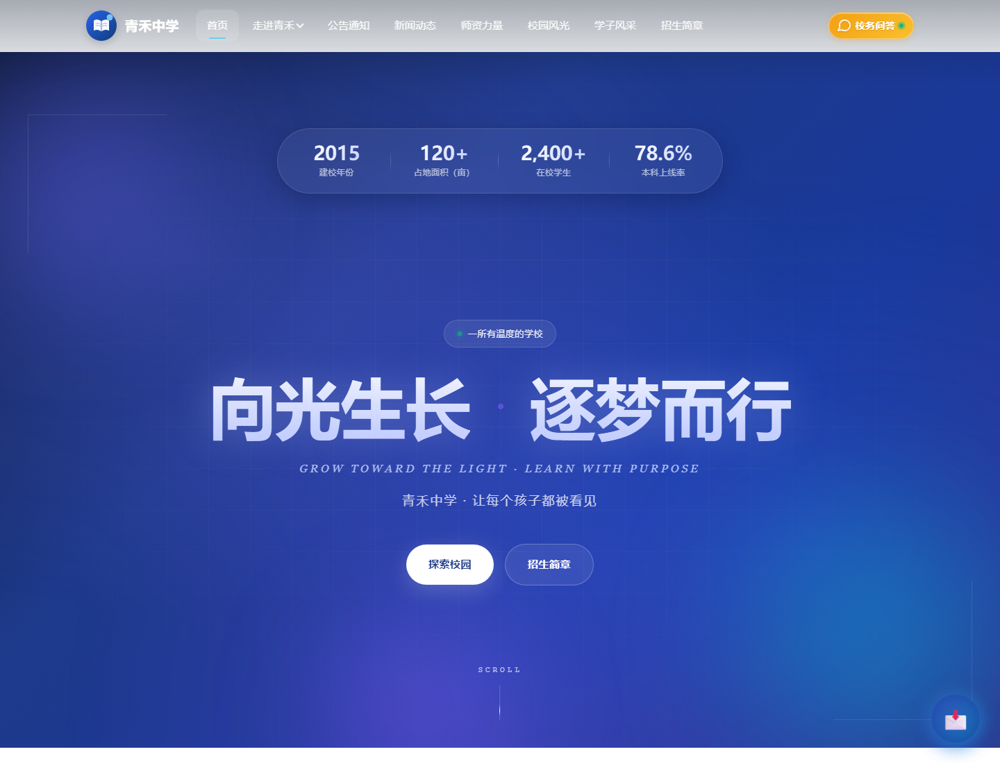

# Campus Site Template · 校园官网模板

一个可以直接改成任何中学或高校官网的静态模板。默认零依赖，起一个本地服务器就能预览。公开仓库包含完整的静态官网、配置化内容和本地 FAQ；需要持久化留言、内容管理后台和 AI 问答时，使用单独授权的 Pro 增强包。

## 包含什么

- **11 个页面**：首页、学校简介、学校故事、公告通知、新闻动态、师资力量、校园风光、学子风采、招生简章、校长信箱、更新日志
- **配置化**：校名、导航、主题色、联系方式、页面文案集中在 <code>assets/js/config.js</code>
- **内容化**：新闻、公告、师资、图集、学子、招生、FAQ、时间线、友链都在 <code>data/*.json</code>
- **响应式**：390 / 768 / 1440 三种宽度下无横向溢出
- **离线可用**：不依赖 CDN、字体服务或第三方脚本
- **本地问答**：内置 FAQ 关键词检索，不需要服务器或大模型
- **可选 Pro**：后端、管理后台、持久化信箱、统计和 AI 问答单独授权
- **无构建步骤**：纯 HTML / CSS / JavaScript，部署到 GitHub Pages、Cloudflare Pages 或任意静态托管

> 站点内所有学校、人物、成绩、电话、地址均为虚构示例。发布前请替换为真实、可公开的信息。

## 快速开始

需要 Node.js 18+（只用于本地预览和自检，部署时不需要）。

~~~bash
npm run dev
# 打开 http://127.0.0.1:8080
~~~

也可以直接用 Python：

~~~bash
python -m http.server 8080
~~~

> 请不要直接双击 <code>index.html</code> 后依赖 JSON 内容，浏览器会以 <code>file://</code> 协议阻止读取 <code>data/*.json</code>。页面壳仍会显示，但列表为空。

自检：

~~~bash
npm run check
~~~

它会检查 JSON、内部链接、页面外壳、配置解析和敏感信息残留。

## 目录

~~~text
.
├── index.html               首页
├── about.html               学校简介
├── story.html               学校故事
├── announcements.html       公告通知
├── news.html                新闻动态
├── teachers.html            师资力量
├── gallery.html             校园风光
├── students.html            学子风采
├── admission.html           招生简章
├── mailbox.html             校长信箱
├── changelog.html           更新日志
├── assets/
│   ├── css/                 样式
│   ├── js/                  config.js / site.js / content.js / chat.js / mailbox.js
│   └── img/                 默认 SVG 占位图
├── data/                    可编辑内容
│   ├── news.json
│   ├── announcements.json
│   ├── teachers.json
│   ├── gallery.json
│   ├── students.json
│   ├── recruitments.json
│   ├── faq.json
│   └── ...
├── docs/                    使用与部署文档
└── tools/                   预览、自检、占位图生成
~~~

## 改成你的学校

只改一个文件就能换品牌：

~~~js
// assets/js/config.js
meta: {
  siteName: '你的学校',
  shortName: '简称',
  slogan: '校训或办学理念',
  url: 'https://你的域名',
},
theme: {
  primary: '#1e40af',
  accent: '#06b6d4',
},
contact: {
  address: '学校地址',
  phone: '学校电话',
  email: '学校邮箱',
},
~~~

然后：

1. 把 <code>data/*.json</code> 换成自己的内容。
2. 把 <code>assets/img/</code> 里的 SVG 换成真实照片（保留文件名即可）。
3. 按 <code>docs/customization.md</code> 调整导航、页面文案和 SEO。

主题色会自动生成深浅色阶，不需要手写一堆 CSS 变量。

## Pro 版（单独授权）

公开仓库是纯静态模式：

- 新闻、公告、招生从 <code>data/*.json</code> 读取
- 校长信箱保存在浏览器 <code>localStorage</code>，仅用于演示
- 问答按钮使用本地 FAQ 检索

Pro 增强包不包含在这个公开仓库里，单独交付，包含：

- 校长信箱持久化、查询码、管理员回复
- 新闻 / 公告 / 招生简章在线管理
- 访问统计
- 邮件通知和自动备份
- FAQ 检索 API
- 可选的 RAG 校务助手（Ollama / LM Studio / 任意 OpenAI 兼容接口）

前端已经预留了接入点。拿到 Pro 包后，在 <code>assets/js/config.js</code> 中设置：

~~~js
api: { base: 'http://127.0.0.1:5000' },
ai:  { endpoint: '/api/chat' },   // 只用 FAQ 时留空
~~~

如果你有自己的后端，也可以按照 <code>docs/pro.md</code> 中的接口契约对接。Pro 的功能、交付方式和许可说明见 <code>docs/pro.md</code>。

## 部署

- **纯静态**：GitHub Pages / Cloudflare Pages / Vercel / Netlify / Nginx
- **Pro / 自建后端**：Nginx 托管静态文件，把 <code>/api</code> 反向代理到 Flask，参考 <code>docs/deployment.md</code>

GitHub Pages 只需要把仓库根目录设为发布目录即可。模板没有构建步骤。

## 开源与商业化

这个仓库默认使用 MIT 许可证，适合：

- 学校自己部署和维护
- 开发者基于它做定制项目
- 作为教学案例或作品集

这个仓库采用“开源核心 + 私有 Pro”的模式：

- 公开仓库：静态官网、配置、内容、本地 FAQ，MIT
- Pro 包：后端、管理后台、持久化信箱、统计、备份、AI，商业许可
- 服务：部署、内容迁移、主题定制、知识库整理、培训、年度维护

具体策略和许可证选择见 <code>docs/monetization.md</code>。注意：MIT 允许他人商用和再分发；如果你希望公开版也限制闭源转售，需要改用 AGPL 或双许可证。

## 文档

- [第一次发布到 GitHub](GITHUB_GUIDE.md)
- [定制指南](docs/customization.md)
- [部署指南](docs/deployment.md)
- [Pro 版与接口契约](docs/pro.md)
- [商业化思路](docs/monetization.md)
- [安全说明](SECURITY.md)

## 许可

公开仓库的代码使用 MIT License。Pro 增强包使用单独的 <code>LICENSE-COMMERCIAL.md</code>，不随本仓库发布。示例文案、SVG 占位图和 JSON 数据可以自由替换。

如果你在学校真实项目中使用，请确保照片、校徽、人物信息和招生数据已经获得授权。
